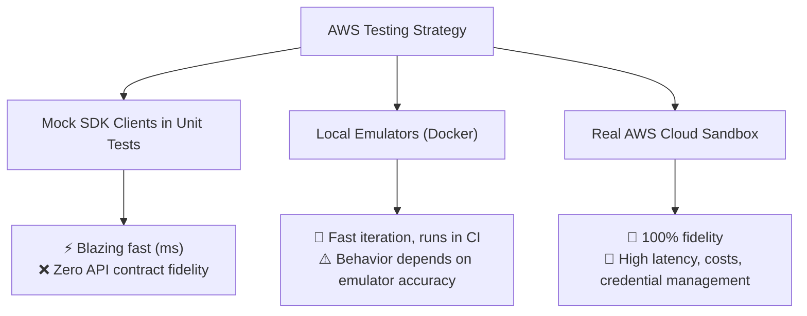
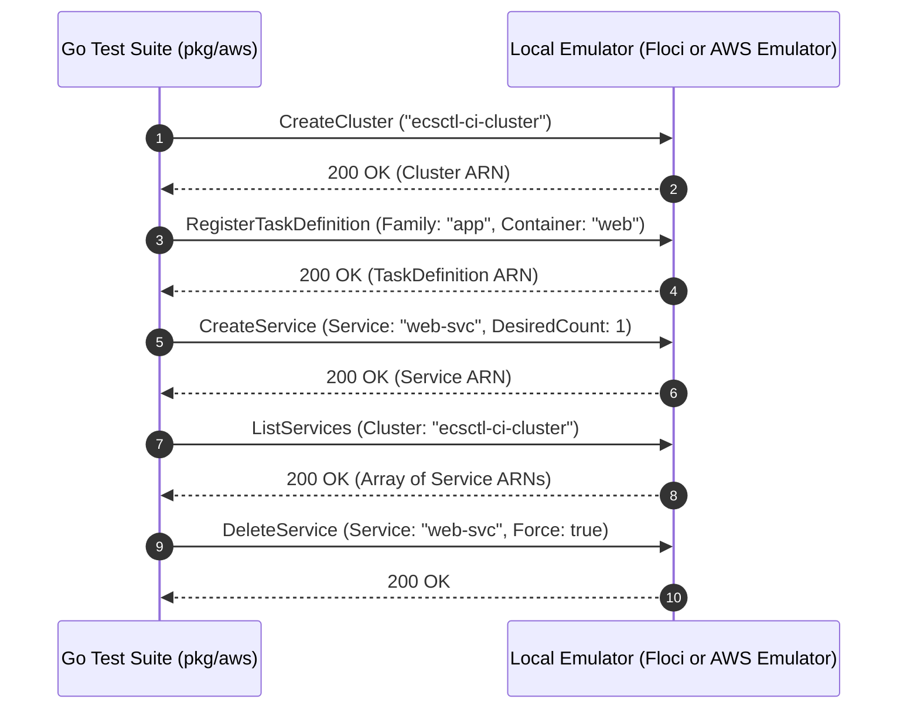
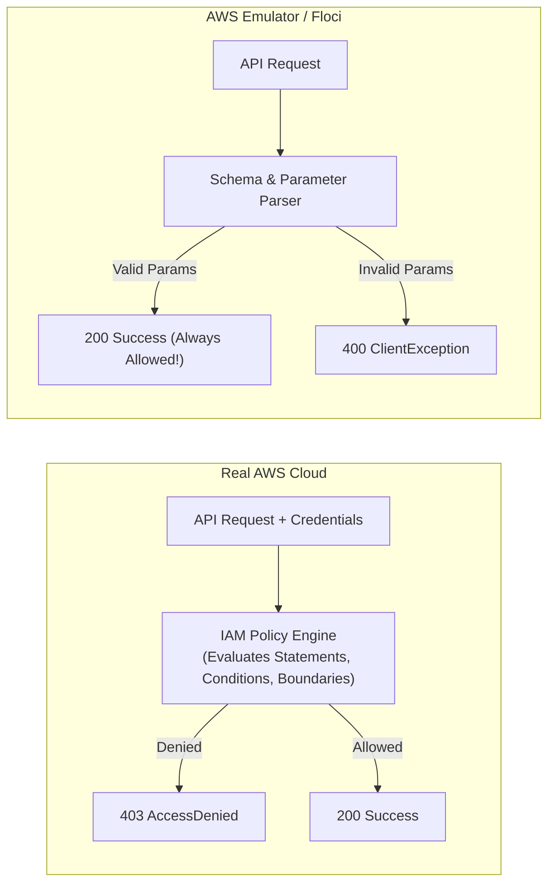
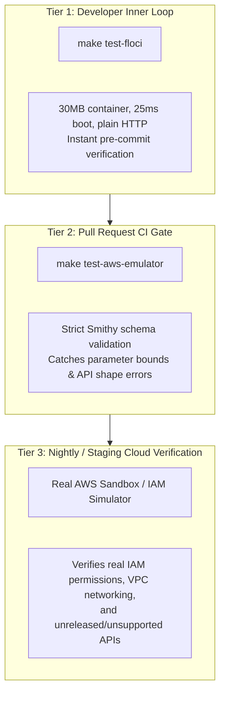

# Testing AWS in CI: Floci vs. The New AWS Emulator (And the IAM Mock Trap)

*By Roslaan & the ecsctl Engineering Team*

---

> **TL;DR**: We ran a side-by-side dual-track experiment comparing the new official **AWS Emulator** against **Floci** in GitHub Actions CI for [`ecsctl`](https://github.com/Roslaan001/ecsctl). While the AWS Emulator caught a real, silent ECS task definition validation bug that Floci completely missed, it also surfaced a critical reminder: **never rely on local emulators to validate IAM policy authorization.** Here are the benchmark numbers, the engineering tradeoffs, and our recommended tiered testing architecture.

---

## 1. The Local AWS Testing Dilemma

Every team building tools or microservices against AWS eventually confronts the same testing dilemma:



For [`ecsctl`](https://github.com/Roslaan001/ecsctl)—an open-source CLI for managing Amazon ECS services, task definitions, and gateway resources—unit testing with Go interfaces only gets us so far. We need integration tests that verify actual HTTP/JSON requests against the AWS API wire format without provisioning real infrastructure for every commit.

For years, tools like **LocalStack** and **Floci** have filled this gap. Recently, AWS introduced its official **AWS Emulator**. We decided to pit Floci and the AWS Emulator against each other in a head-to-head dual-track experiment in both our local developer environment and GitHub Actions CI.

---

## 2. Meet the Contenders

### Floci
- **What it is**: An ultra-lightweight, high-performance mock server for common AWS APIs.
- **Engine**: Custom in-memory Go daemon.
- **Docker Image**: `floci/floci:2.1.0` (~30 MiB).
- **Transport**: Plain HTTP on port `4566`.
- **Target Persona**: Developers who want instant test startup with zero configuration overhead.

### AWS Emulator
- **What it is**: The official local AWS emulator published by AWS (distributed as an RPM from `downloads.aws.com` and containerized via our own `Dockerfile.aws-emulator` on `public.ecr.aws/amazonlinux/amazonlinux:2023-minimal`).
- **Engine**: Built directly against AWS Smithy service models.
- **Docker Image**: ~295 MiB (uncompressed installed size).
- **Transport**: HTTPS on port `9297` with a built-in self-signed Certificate Authority (CA).
- **Target Persona**: Teams looking for strict API contract fidelity, official AWS parameter validation, and verified software provenance.

---

## 3. The Experiment Setup

To ensure a fair comparison, we abstracted our integration test suite in Go so the exact same lifecycle ran against both emulators without modifying test logic:



### Addressing the Transport Difference
- **Floci**: Accepts plain HTTP. We configure our AWS SDK client endpoint to `http://127.0.0.1:4566`.
- **AWS Emulator**: Enforces HTTPS. The emulator generates its own internal root CA on startup. To avoid disabling TLS verification in production client paths, our CI workflow extracts the container's CA certificate and registers it in the host cert pool:

```yaml
- name: Setup AWS Emulator TLS CA
  run: |
    # The emulator writes its generated CA to its port-specific runtime directory
    docker cp aws-emulator:/home/emulator/.aws/emulator/9297/ca.pem /usr/local/share/ca-certificates/aws-emulator.crt
    sudo update-ca-certificates
```

---

## 4. Head-to-Head Benchmarks

We ran both emulators locally and in GitHub Actions runner (`ubuntu-latest`, [CI Run #43723525064](https://github.com/Roslaan001/ecsctl/actions/runs/43723525064)):

| Benchmark Metric | Floci (`v2.1.0`) | AWS Emulator (`latest`) | Delta |
| :--- | :--- | :--- | :--- |
| **Image Size (Docker)** | `30.4 MiB` | `295.2 MiB` | AWS Emulator is **~9.7x larger** |
| **Container Startup Latency** | `~25 ms` | `~80 ms` | Floci is **~3.2x faster** |
| **Total CI Job Duration** | `1m 26s` | `1m 40s` | Floci is **14s faster** |
| **Pure Go Test Execution** | `0.02s` | `0.01s` | Negligible / Parity |
| **Default Protocol** | `HTTP (4566)` | `HTTPS (9297)` | AWS Emulator mimics real TLS |
| **AWS Managed Policies Pre-seeded**| No (Returns 404) | Yes (Pre-populated) | AWS Emulator wins |
| **Parameter Validation Fidelity** | Permissive | Strict (Smithy) | AWS Emulator wins |

> [!NOTE]
> The 14-second difference in total CI job time was entirely consumed by pulling the larger 295 MiB container image and updating the system CA trust store. Once the daemon is warm, raw API execution latency on both tools is sub-20 milliseconds.

---

## 5. The Surprise: AWS Emulator Caught a Real Bug

The most compelling argument for the AWS Emulator happened in the first two minutes of our test run. 

In our test fixture, we registered a standard ECS task definition:

```go
input := &ecs.RegisterTaskDefinitionInput{
    Family: awssdk.String("ecsctl-test-family"),
    ContainerDefinitions: []types.ContainerDefinition{
        {
            Name:  awssdk.String("app"),
            Image: awssdk.String("nginx:latest"),
            // Memory was omitted here!
        },
    },
}
```

- **Floci's Response**: `HTTP 200 OK`. The task definition was accepted and registered.
- **AWS Emulator's Response**:
  ```text
  operation error ECS: RegisterTaskDefinition, https response error StatusCode: 400, 
  RequestID: 550e8400-e29b-41d4-a716-446655440000, api error ClientException: 
  Invalid setting for container 'app': memory or memoryReservation must be specified.
  ```

Because the AWS Emulator is generated against official AWS Smithy model schemas, it enforces real ECS API constraints. Real Amazon ECS rejects container definitions that omit both `Memory` and `MemoryReservation` unless task-level CPU and memory are specified for Fargate.

**Floci's mock implementation had silently allowed invalid configuration to pass.** If an engineer had relied solely on Floci, this task definition would have shipped to staging and failed on real AWS.

---

## 6. The Danger Zone: The "IAM Mock Trap"

While parameter validation is high-fidelity, the AWS Emulator introduces a major behavioral trap around AWS Identity & Access Management (IAM).

### The Illusion of Working IAM
When interacting with AWS Emulator:
1. You can call `iam:CreateRole` and `iam:AttachRolePolicy`.
2. Official AWS managed policy ARNs (such as `arn:aws:iam::aws:policy/AmazonECSInfrastructureRoleForGatewayHostSharedALB`) are already pre-seeded in the database, avoiding annoying `NoSuchEntity` 404 errors.
3. Everything appears to work cleanly.

### The Reality: Zero Authorization Enforcement
However, **the AWS Emulator does not evaluate IAM policies for authorization.**



If you attach an IAM policy that has:
- A typo in the `Action` list,
- An invalid `Condition` block (e.g. `aws:SourceAccount`),
- Missing permissions for `ecs:CreateService`,

...**the AWS Emulator will still return `200 OK` and execute the action.**

> [!WARNING]
> Testing IAM policies against local emulators creates a dangerous illusion of security. Never use emulator pass/fail results as proof that your IAM policies are correctly scoped or functional.

### What to Use for IAM Validation Instead
If you need to test IAM policies before deploying:
1. **AWS IAM Policy Simulator**: Use the `aws iam simulate-principal-policy` or `aws iam simulate-custom-policy` APIs. These run through AWS’s actual evaluation engine and test statement logic without deploying live infrastructure.
2. **Dedicated Cloud Sandbox Account**: Run a disposable smoke test in an isolated AWS sandbox account in your deployment pipeline.

---

## 7. The Bleeding-Edge Gap

Another observation during our experiment: when testing cutting-edge features like **Amazon ECS Gateway** (`CreateGateway`), the AWS Emulator returned:

```text
501 NotImplemented: operation CreateGateway is scaffolded but not implemented in this emulator
```

Even official emulators lag behind recently released AWS services and specialized APIs. Your architecture should always be prepared to mock or bypass unsupported endpoints.

---

## 8. Recommended Architecture: The Tiered Validation Model

Rather than choosing between Floci and the AWS Emulator, the best outcome for [`ecsctl`](https://github.com/Roslaan001/ecsctl) was adopting a **Tiered Validation Model**:



### Makefile Setup
```makefile
.PHONY: test-floci test-aws-emulator test-emulators

test-floci:
	docker compose up -d floci
	AWS_ENDPOINT_URL=http://localhost:4566 go test -v ./pkg/aws -run TestLocalEmulator
	docker compose down

test-aws-emulator:
	docker compose -f docker-compose.aws-emulator.yml up -d --build
	docker compose -f docker-compose.aws-emulator.yml cp aws-emulator:/home/emulator/.aws/emulator/9297/ca.pem /tmp/ecsctl-aws-emulator-ca.pem
	AWS_CA_BUNDLE=/tmp/ecsctl-aws-emulator-ca.pem AWS_ENDPOINT_URL=https://127.0.0.1:9297 go test -v ./pkg/aws -run TestLocalEmulator
	docker compose -f docker-compose.aws-emulator.yml down

test-emulators: test-floci test-aws-emulator
```

---

## 9. Conclusion

The new AWS Emulator is a massive step forward for local cloud development. Its Smithy-backed parameter validation is far superior to third-party mocks and proactively eliminates deployment-time runtime errors.

However, keep its limitations in mind:
- **Keep Floci around** when developer velocity, instant test execution, and minimal disk footprint matter most.
- **Use AWS Emulator in CI** to guard against invalid API parameters and malformed definitions.
- **Never trust emulators for IAM authorization**—leave permission auditing to the AWS IAM Policy Simulator and dedicated cloud environments.

*Have you experimented with the new AWS Emulator in your CI pipelines? Check out how we implemented dual-track testing in [ecsctl PR #60](https://github.com/Roslaan001/ecsctl/pull/60)!*
